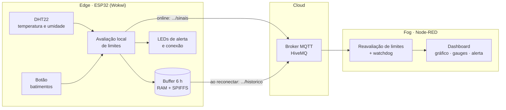
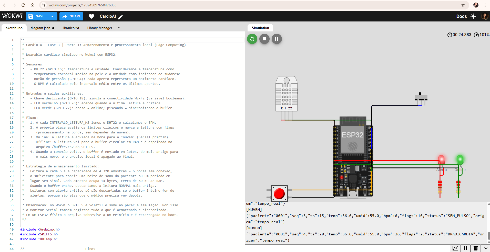
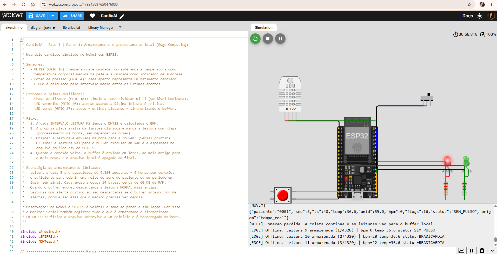
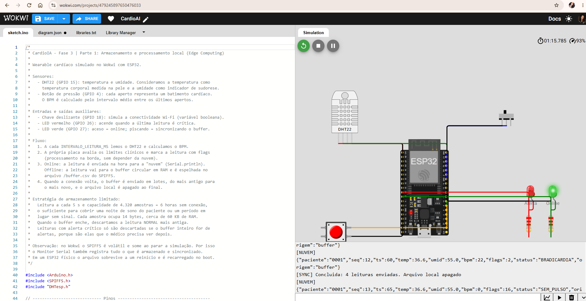
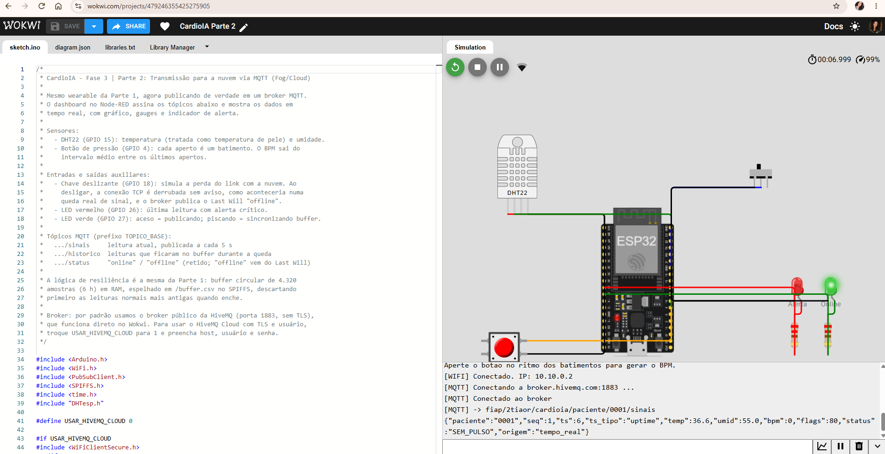
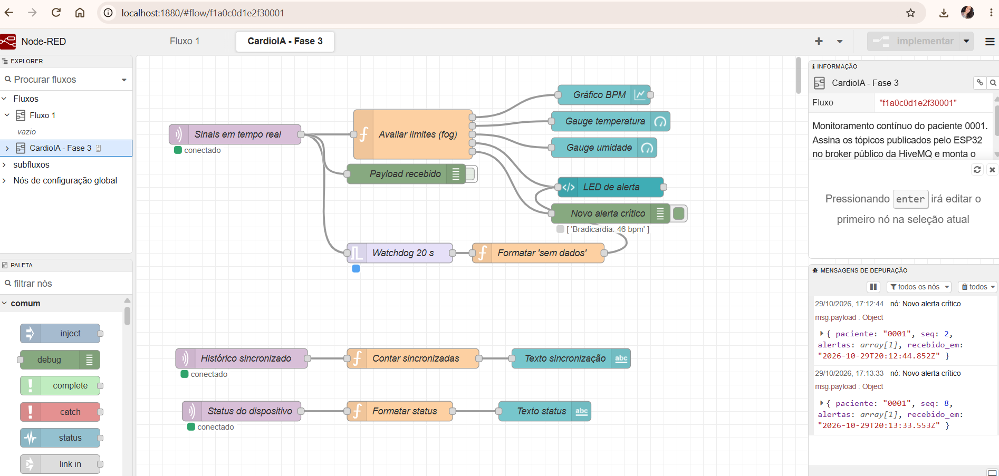
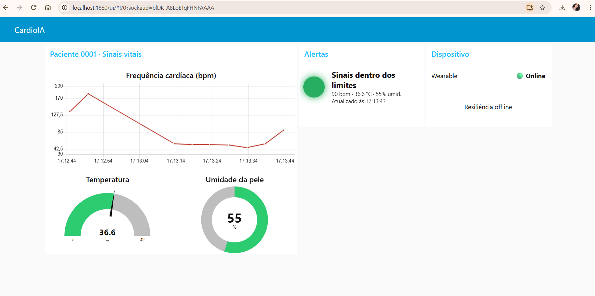
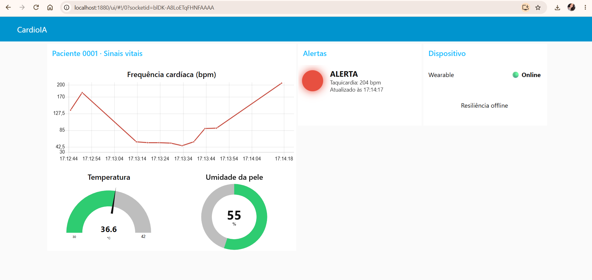
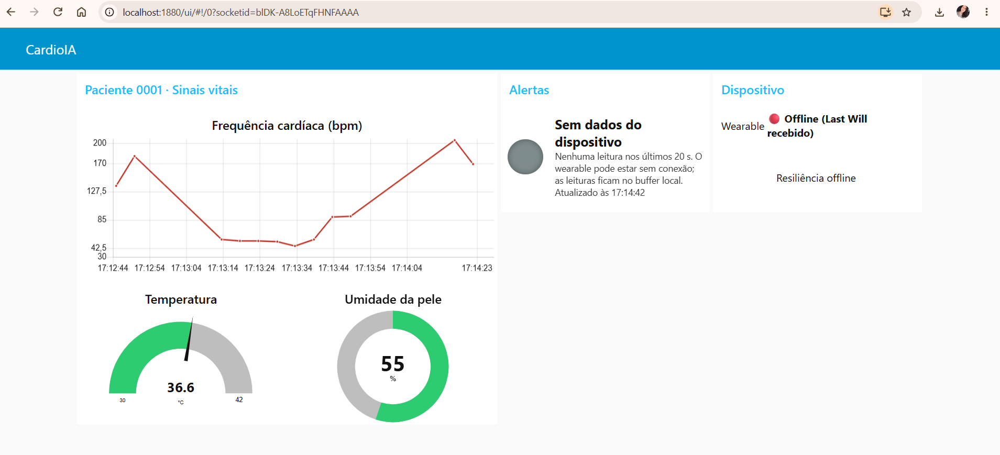
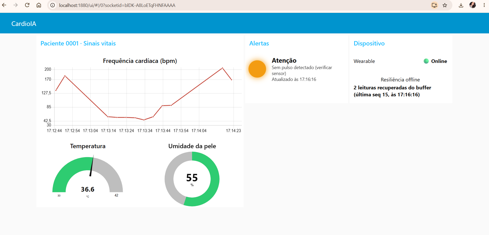

# FIAP - Faculdade de Informática e Administração Paulista

<p align="center">
<a href="https://www.fiap.com.br/">
  
</a>
</p>

<br>

# CardioIA — Fase 3: Monitoramento Contínuo (IoT na Saúde)

## Ecossistema de Cardiologia Inteligente (Graduação ON em Inteligência Artificial)

## 👨‍🎓 Integrantes: 
- <a href="https://www.linkedin.com/in/bernardo-doti/">Bernardo Naves Doti Avelar - RM566867</a>
- <a href="https://www.linkedin.com/in/eduardo-correia-29327631/">David Eduardo da Silva Correia - RM567525</a>
- <a href="https://www.linkedin.com/in/laura-castilho/">Laura de Andrade Castilho - RM568507</a> 
- <a href="https://www.linkedin.com/in/leticiagdornelas/">Leticia Grossi Dornelas - RM568172</a> 
- <a href="https://www.linkedin.com/in/leonardo-borges-alves-da-mota-649703177/">Leonardo Borges Alves da Mota - RM566939</a>

## 👩‍🏫 Professores:
### Tutor
- <a href="https://www.linkedin.com/in/leonardoorabona/">Leonardo Orabona</a>
### Coordenador
- <a href="https://www.linkedin.com/in/andregodoichiovato/">André Godoi Chiovato</a>


## 📜 Descrição

Na Fase 1 do CardioIA montamos a base de dados do projeto: pacientes simulados, textos clínicos e imagens de ECG. Nesta **Fase 3** o foco muda para o paciente fora do hospital. A proposta é simular um **wearable cardíaco** que acompanha sinais vitais continuamente, processa as leituras no próprio dispositivo, envia os dados para a nuvem e mostra tudo em um dashboard com alertas automáticos.

O protótipo foi construído com um **ESP32 no simulador Wokwi**. Ele usa um sensor **DHT22**, que mede temperatura e umidade, e um **botão de pressão** que representa os batimentos cardíacos: cada aperto é um batimento, e o BPM é calculado pelo intervalo entre os apertos. Uma chave deslizante simula a conexão Wi-Fi caindo e voltando, e dois LEDs mostram o estado de alerta e de conexão.

O trabalho está dividido nas duas partes pedidas no enunciado:

1. **Parte 1 – Edge Computing.** O ESP32 coleta e avalia as leituras localmente. Sem conexão, guarda tudo em um buffer de até 6 horas, espelhado no SPIFFS, e sincroniza quando a conexão volta.
2. **Parte 2 – Fog/Cloud Computing.** As leituras são publicadas via **MQTT** no broker da **HiveMQ** e consumidas por um fluxo no **Node-RED**. Esse fluxo reavalia os limites clínicos e monta um dashboard com gráfico de BPM, gauges de temperatura e umidade, um LED virtual de alerta e o status do dispositivo.

O ciclo completo fica assim: **captura → processamento → transmissão → visualização → alerta**.




## 📁 Estrutura de pastas

- <b>src/esp32/parte1_edge</b>: Firmware da Parte 1 (`sketch.ino`), circuito do Wokwi (`diagram.json`) e bibliotecas (`libraries.txt`).
- <b>src/esp32/parte2_mqtt</b>: Firmware da Parte 2, com Wi-Fi, NTP e MQTT, no mesmo circuito.
- <b>src/node-red</b>: Fluxo do Node-RED exportado (`flows_cardioia.json`), pronto para importar.
- <b>docs/relatorios</b>: Relatório da Parte 1 (fluxo e resiliência) e relatório da Parte 2 (MQTT e dashboard).
- <b>docs/prints</b>: Prints do Wokwi, do fluxo e do dashboard.
- <b>Ir Além</b>: Atividades opcionais, não desenvolvidas nesta fase.
- <b>data</b>, <b>docs/textos</b>, <b>docs/amostras_ecg</b> e os scripts Python em <b>src</b>: material da Fase 1, mantido no repositório (ver seção "Fases anteriores").


---

## 🔌 Parte 1 — Armazenamento e processamento local (Edge Computing)

**Projeto no Wokwi:** <https://wokwi.com/projects/479245897650476033>
**Código comentado:** [`src/esp32/parte1_edge/sketch.ino`](src/esp32/parte1_edge/sketch.ino)
**Relatório:** [`docs/relatorios/relatorio_parte1_edge.md`](docs/relatorios/relatorio_parte1_edge.md)

| Componente | Pino | Função |
|---|---|---|
| DHT22 | GPIO 15 | Temperatura (pele) e umidade (sudorese). |
| Botão de pressão | GPIO 4 | Batimentos cardíacos (1 aperto = 1 batimento). |
| Chave deslizante | GPIO 18 | Conectividade Wi-Fi simulada. |
| LED vermelho | GPIO 26 | Alerta crítico na última leitura. |
| LED verde | GPIO 27 | Online (aceso) ou sincronizando (piscando). |

**Como funciona a resiliência.** A cada 5 s o ESP32 lê os sensores e avalia os limites clínicos na própria placa. Com a chave em "conectado", a leitura sai na hora pelo `Serial.println`, que representa a nuvem. Com a chave em "desconectado", a leitura vai para um buffer circular em RAM e para o arquivo `/buffer.csv` no SPIFFS. Quando a conexão volta, o buffer é enviado em lotes, do mais antigo para o mais novo, e o arquivo é apagado.

**Estratégia de armazenamento limitado.** O buffer guarda **4.320 amostras, o equivalente a 6 horas offline**, pensando em uma noite de sono longe do roteador. Cada amostra ocupa 14 bytes, cerca de 60 KB no total. Se o buffer encher, sai primeiro a **leitura normal mais antiga**, e os alertas críticos são preservados. Como o SPIFFS é volátil no Wokwi, o Monitor Serial registra cada armazenamento e cada sincronização como evidência.


## ☁️ Parte 2 — Transmissão para nuvem e visualização (Fog/Cloud Computing)

**Projeto no Wokwi:** <https://wokwi.com/projects/479246355425275905>
**Código do ESP32:** [`src/esp32/parte2_mqtt/sketch.ino`](src/esp32/parte2_mqtt/sketch.ino)
**Fluxo do Node-RED:** [`src/node-red/flows_cardioia.json`](src/node-red/flows_cardioia.json)
**Relatório:** [`docs/relatorios/relatorio_parte2_mqtt_dashboard.md`](docs/relatorios/relatorio_parte2_mqtt_dashboard.md)

O ESP32 publica no broker público `broker.hivemq.com:1883`, com suporte opcional ao HiveMQ Cloud com TLS. Os tópicos são:

| Tópico | Conteúdo |
|---|---|
| `fiap/2tiaor/cardioia/paciente/0001/sinais` | Leitura atual (JSON), a cada 5 s. |
| `fiap/2tiaor/cardioia/paciente/0001/historico` | Leituras do buffer enviadas depois de uma queda. |
| `fiap/2tiaor/cardioia/paciente/0001/status` | `online` / `offline`, retido, com `offline` vindo do Last Will. |

O dashboard do Node-RED tem:

- **Gráfico** da frequência cardíaca, com os últimos 10 minutos.
- **Gauge** de temperatura, com faixas coloridas nos limites clínicos, e gauge de umidade.
- **LED virtual de alerta**: verde, laranja, vermelho piscando ou cinza quando o dispositivo para de enviar.
- **Status do dispositivo** e contador de leituras recuperadas do buffer.

### Limites de alerta definidos pelo grupo

| Condição | Limite | Nível |
|---|---|---|
| Taquicardia | BPM > 120 | Crítico |
| Bradicardia | BPM < 50 | Crítico |
| Febre | Temperatura ≥ 38,0 °C | Crítico |
| Hipotermia | Temperatura < 35,0 °C | Crítico |
| Sem pulso / falha no sensor | BPM = 0 ou DHT22 sem leitura | Atenção |
| Dispositivo sem enviar | 20 s sem mensagens | Sem dados |

Os limites são avaliados no ESP32, para os alertas locais funcionarem sem internet, e novamente no Node-RED, onde podem ser ajustados por paciente sem regravar o firmware.


## 📸 Evidências

| Parte 1 – online | Parte 1 – offline | Parte 1 – sincronização |
|---|---|---|
|  |  |  |

| Parte 2 – MQTT no Wokwi | Fluxo no Node-RED |
|---|---|
|  |  |

| Dashboard normal | Dashboard em alerta | Dashboard sem dados |
|---|---|---|
|  |  |  |

| Dashboard após a sincronização do buffer |
|---|
|  |


## 🔧 Como executar o código

### Wokwi (Partes 1 e 2)

1. Acesse <https://wokwi.com> e crie um novo projeto **ESP32**.
2. Substitua o conteúdo de `sketch.ino` e `diagram.json` pelos arquivos da pasta da parte desejada.
3. No **Library Manager** do Wokwi, adicione as bibliotecas listadas em `libraries.txt`: `DHT sensor library for ESPx` e, na Parte 2, `PubSubClient`.
4. Inicie a simulação e abra o Monitor Serial.
5. Aperte o botão vermelho no ritmo dos batimentos. Clicar no DHT22 permite mudar a temperatura e a umidade. A chave deslizante liga e desliga a conexão.

### Node-RED (Parte 2)

Pré-requisitos: Node.js 18 ou superior.

```bash
npm install -g --unsafe-perm node-red
node-red
```

1. Abra <http://localhost:1880>, vá em **Menu → Gerenciar paleta → Instalar** e instale `node-red-dashboard`.
2. Vá em **Menu → Importar**, selecione o arquivo `src/node-red/flows_cardioia.json` e clique em **Deploy**.
3. Abra o dashboard em <http://localhost:1880/ui>.
4. Com a simulação da Parte 2 rodando no Wokwi, os dados aparecem em poucos segundos.

### Usando o HiveMQ Cloud em vez do broker público

No `sketch.ino` da Parte 2, troque `USAR_HIVEMQ_CLOUD` para `1` e preencha host, usuário e senha do cluster. No Node-RED, edite o nó de broker para a porta 8883, com TLS habilitado e as mesmas credenciais.


## 🗂 Fases anteriores

O material da **Fase 1 – Batimentos de Dados** continua no repositório: dataset numérico em `data/`, textos para NLP em `docs/textos/`, amostras de ECG em `docs/amostras_ecg/` e os scripts geradores em `src/`. O README completo daquela entrega pode ser consultado no histórico do repositório: <https://github.com/LauraCastilho/2TIAOR-CardioIA-Fase1-Cap1/blob/f5064d3/README.md>.


## 📎 Links e Observações

- <b>Repositório GitHub</b>: <https://github.com/LauraCastilho/2TIAOR-CardioIA-Fase1-Cap1>
- <b>Wokwi – Parte 1</b>: <https://wokwi.com/projects/479245897650476033>
- <b>Wokwi – Parte 2</b>: <https://wokwi.com/projects/479246355425275905>
- <b>Explicação de decisões técnicas</b>: ver os dois relatórios em `docs/relatorios`.
- <b>Observações Gerais</b>: atividade não está vinculada a nenhuma competição externa. O broker público foi usado apenas com dados simulados. Os cuidados para uso com dados reais estão na seção de segurança do relatório da Parte 2.


## 🗃 Histórico de lançamentos

* 0.3.0 - 29/10/2026
    * Entrega da Fase 3 – Monitoramento Contínuo: wearable simulado com ESP32 (DHT22 + botão de batimentos), resiliência offline com buffer de 6 h, publicação MQTT na HiveMQ e dashboard no Node-RED com alertas.
* 0.1.0 - 18/08/2026
    * Entrega da Fase 1 – Batimentos de Dados: dataset numérico simulado (300 pacientes), dois textos reais para NLP e 150 imagens de ECG sintéticas.

---


## 📋 Licença

<p xmlns:cc="http://creativecommons.org/ns#" xmlns:dct="http://purl.org/dc/terms/"><a property="dct:title" rel="cc:attributionURL" href="https://github.com/SabrinaOtoni/TEMPLATE-FIAP-GRAD-ON-IA">MODELO GIT FIAP</a> por <a rel="cc:attributionURL dct:creator" property="cc:attributionName" href="https://fiap.com.br">FIAP</a> está licenciado sobre <a href="http://creativecommons.org/licenses/by/4.0/?ref=chooser-v1" target="_blank" rel="license noopener noreferrer" style="display:inline-block;">Attribution 4.0 International</a>.</p>
